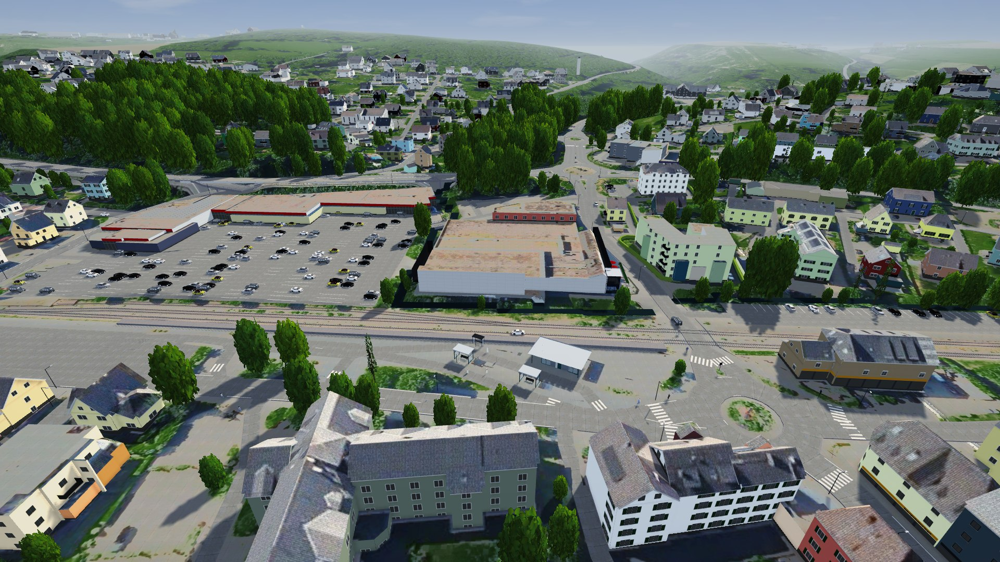
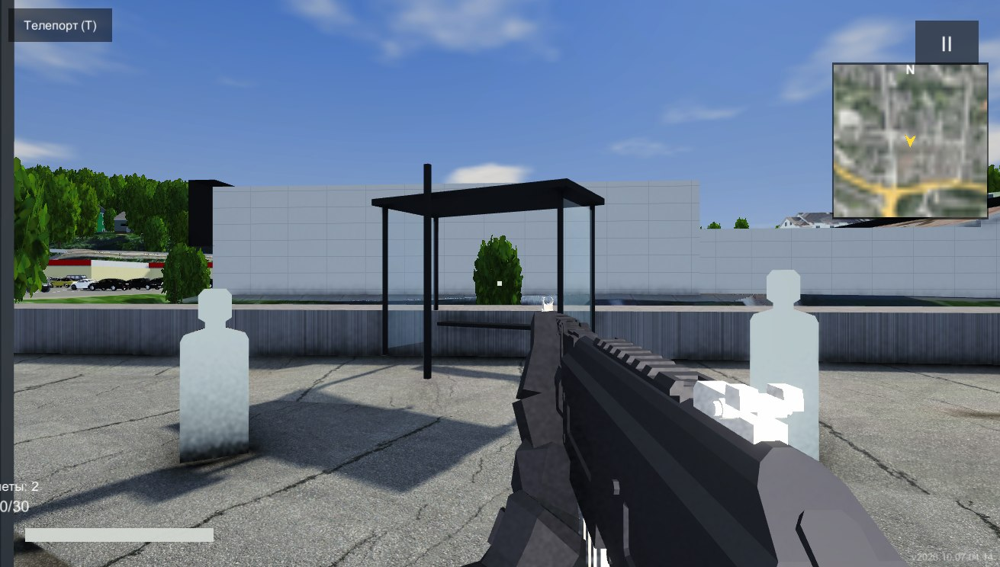
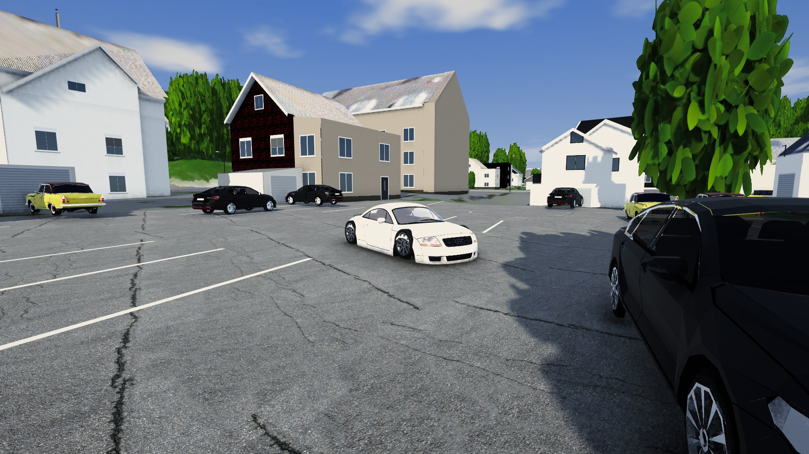
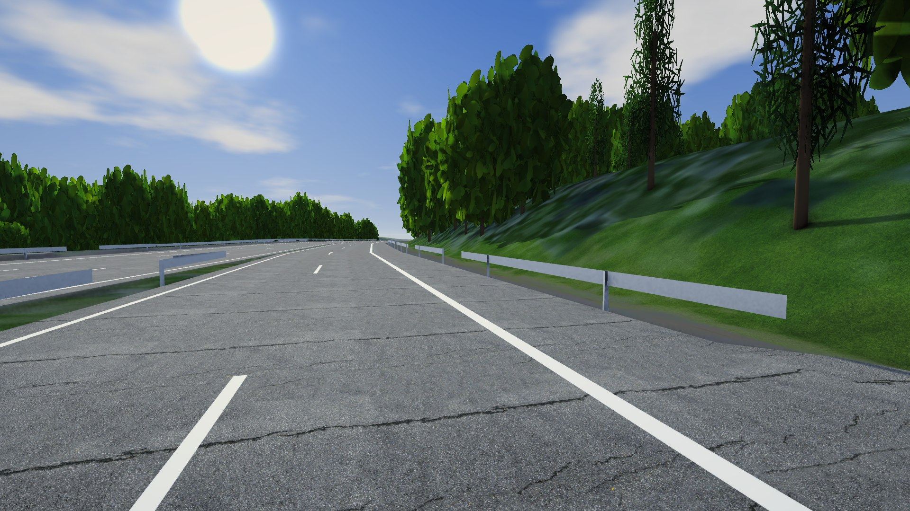
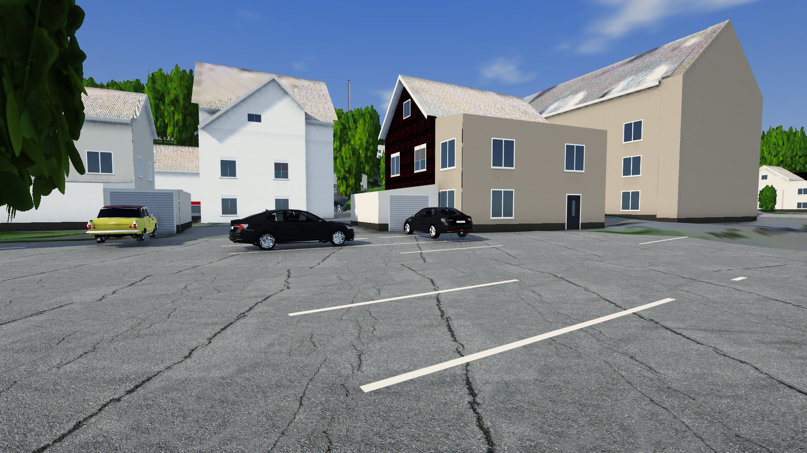
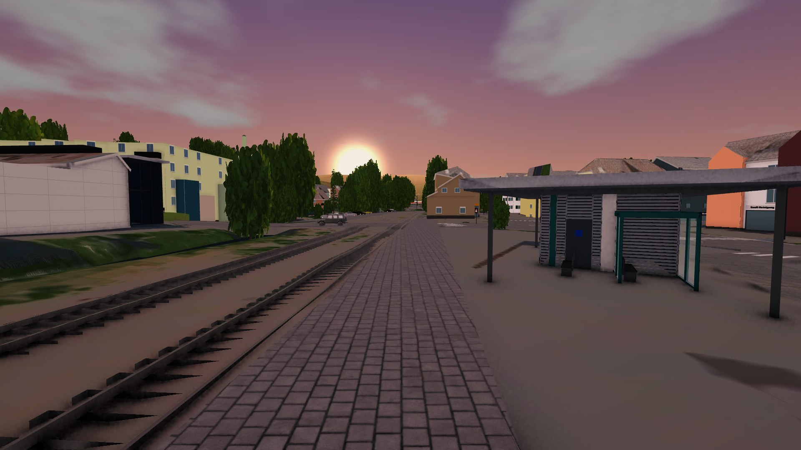
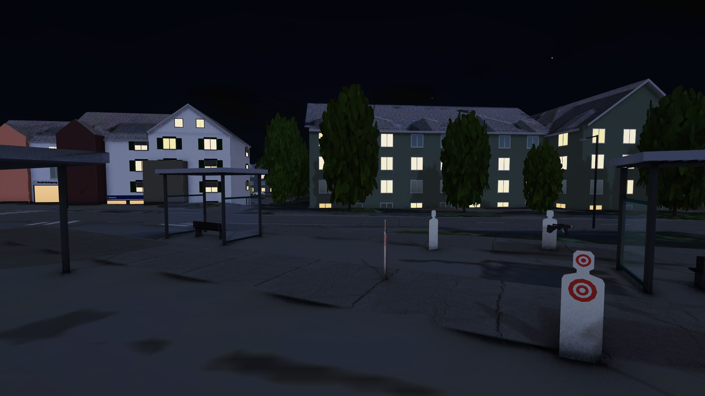
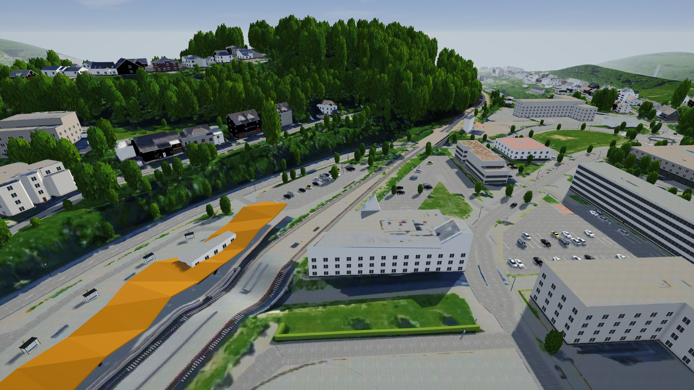
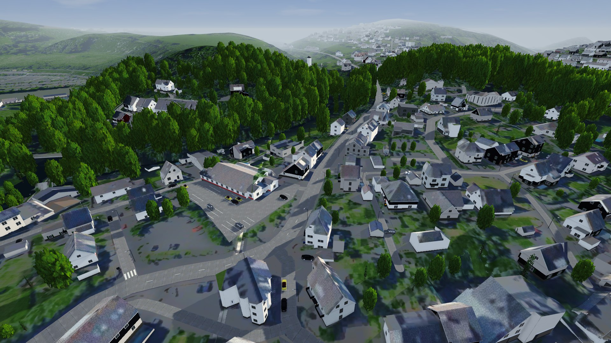
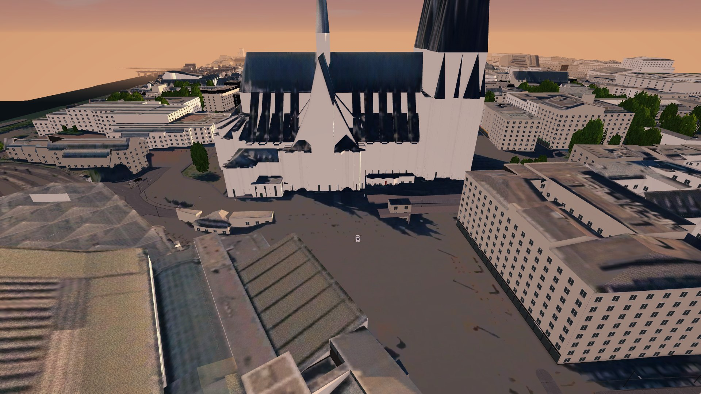

# Dexstand — open-world shooter and driving sim on a real map of NRW

**EN** · A Unity 6 game set in a real place: the town of Wiehl and its region in North Rhine-Westphalia, plus the A4 Autobahn all the way into the centre of Köln — ~300 map tiles built from government open data ([wiehl-map](https://github.com/IvanHarhan/wiehl-map)). First-person shooting, a realistic car with a manual gearbox, AI traffic and pedestrians, day/night, multiplayer through Photon Fusion. Started as a learning project; the driving part became a trainer for my own German driving test.

**DE** · Ein Unity-6-Spiel an einem echten Ort: die Stadt Wiehl und ihre Umgebung in NRW sowie die A4 bis in die Kölner Innenstadt – rund 300 Kartenkacheln aus offenen Geodaten ([wiehl-map](https://github.com/IvanHarhan/wiehl-map)). Ego-Shooter, ein realistisches Auto mit Schaltgetriebe, KI-Verkehr und Fußgänger, Tag/Nacht, Multiplayer über Photon Fusion. Als Lernprojekt begonnen; der Fahrteil wurde zu einem Trainer für meine eigene Führerscheinprüfung.

## Download (Windows)

**[Releases → Dexstand-Windows.7z.001 … .008](https://github.com/IvanHarhan/dexstand/releases/latest)** — download all parts into one folder, open `.001` with [7-Zip](https://www.7-zip.org/), run `Dexstand.exe`. ~3.7 GB packed, ~5.8 GB unpacked.

## Screenshots

| | |
|---|---|
|  |  |
|  |  |
|  |  |
|  |  |

*Wiehl · first person · Audi TT in Dieringhausen · A4 by Engelskirchen · street in Dieringhausen · evening and night at Wiehl bus station · Gummersbach (Forum) · Bielstein · Köln Dom/Hbf*

## Controls (PC)

| | |
|---|---|
| WASD, mouse, LMB | move, aim, shoot |
| T | teleport menu (towns, A4, Köln) |
| F7 | bring the car here |
| K | engine start/stop |
| W / S | throttle / brake |
| Shift | clutch |
| 1–7, 0, R | gears (manual), neutral, reverse |
| G | manual ⇄ automatic |
| Space | handbrake |
| F3 | driving assists (ABS/TCS/ESC) |
| H | help |

## What I built

**Map streaming** — the map is ~300 tiles of 500 m. In the editor they load from `Resources`, in the build each tile is its own AssetBundle (one big `resources.assets` passed 4 GB and crashed the player build). `MapTileStreamer` loads and unloads around the player; Köln gets its own draw distance.

**Car physics** (`CarDrivetrain.cs`, `SimpleCar.cs`, `CarSpecs.cs`) — own physics instead of WheelColliders: engine torque curve, idle governor, starter and stalling, clutch bite point, manual and automatic gearbox, Pacejka-style tyre curve on combined slip with a friction circle, springs/dampers with anti-roll bars, ABS/TCS/ESC. The world is at 1/3 scale, so gravity is g/3 too (Froude scaling keeps real-time dynamics). Measured on the Audi TT model: 0–100 km/h in 6.3 s (brochure: 6.4 s), 100–0 in 41 m.

**Traffic** (`MapTraffic.cs`) — pure-pursuit steering along the road graph, time-gap following, junction reservations, pitch from axle rays. Automated test: zero overlaps, jumps or off-road cars.

**Shooting** — first-person arms and weapons with runtime IK, recoil in both the networked aim and the view model, decals, tracers, pop-up targets.

**Multiplayer** — Photon Fusion (host/client), networked input including car pedals.

**Editor automation** (`Assets/Editor/`) — the open editor is driven by a trigger file: rebuild the scene and player, run play-mode tests (`CarTestTrigger`: dynamics, manual box, traffic), take screenshots, build the game. Most of the testing was done this way, without clicking through the editor.

**Tools** — `blender_tools/`: Blender Python scripts for characters (MPFB → Unity humanoid), rig checks and texture generation.

## Repository contents

Only my own code is here (~25 000 lines of C#). Third-party assets used in the game are **not** included: Photon Fusion SDK, Infima Games "Low Poly Shooter Pack – Free Sample", Quaternius / OpenGameArt CC0 models, Sketchfab CC-BY cars. To open the project you would need to add them from the Asset Store / their sites.

Unity 6000.2.10f1 · URP · Photon Fusion · new Input System
